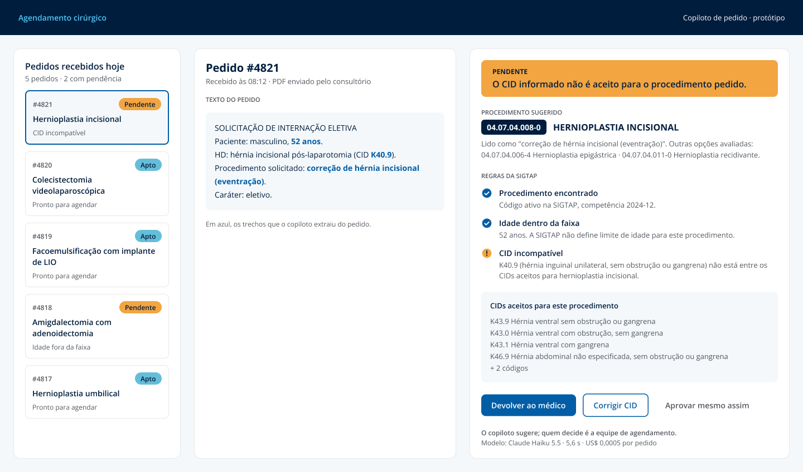

# Copiloto de pedido cirúrgico

Protótipo com LLM que lê um pedido de cirurgia eletiva escrito em texto livre, identifica o procedimento na tabela SIGTAP do SUS e checa o pedido contra as regras oficiais antes de ele entrar na fila. O objetivo é pegar na origem o pedido que voltaria depois por CID incompatível, idade fora da faixa ou falta de informação.

```
$ python src/copiloto.py "Pcte fem 45a. HD: colelitíase (K80.2). Solicito CCL VLP." anthropic/claude-haiku-5.5

Procedimento: 0407030034 - COLECISTECTOMIA VIDEOLAPAROSCÓPICA
CID: K802 | Idade: 45 | Sexo: F
Situação: APTO
Custo: US$ 0.0005 | 5.3 s
```



*Protótipo da tela de revisão no Figma: a fila de pedidos, o texto original com os trechos que o copiloto extraiu e a sugestão com as regras da SIGTAP checadas. No exemplo, o médico informou K40.9 (hérnia inguinal) num pedido de hernioplastia incisional, e a tela mostra os CIDs que a SIGTAP aceita para o procedimento.*

## O problema

Na jornada cirúrgica, o pedido médico chega em texto livre: abreviações ("CCL VLP"), sinônimos ("adenotonsilectomia"), CID com ou sem ponto ou só por extenso. Quem agenda precisa traduzir isso para o código SIGTAP e conferir se o CID e a idade são compatíveis com o procedimento. Quando o erro passa, o pedido volta dias depois, e a cirurgia atrasa.

## Como o produto foi construído

| Etapa | Ferramenta | Entrega |
|---|---|---|
| Discovery | Python | Regras da SIGTAP, 120 pedidos sintéticos com gabarito |
| Especificação | Confluence | [PRD](https://ytaramelli.atlassian.net/wiki/spaces/COPILOTO/overview) com personas, hipóteses, requisitos, resultados e caminho para produção |
| Backlog | Jira | 4 épicos (discovery, protótipo, validação, produção) com histórias, tarefas e bugs encontrados na avaliação |
| Protótipo | Python + LLM | Copiloto com Gemini e Claude, avaliado em duas iterações |
| Design | Figma | [Tela de revisão do pedido](https://www.figma.com/design/8tIe5wNVz3boqLHi0qIV8A?node-id=6-35) |

## Como funciona

```
pedido em texto ──► 1. LLM extrai os campos ──► 2. busca na SIGTAP ──► 3. LLM escolhe ──► 4. regras SIGTAP ──► apto / pendências
                      procedimento, CID,         candidatos por          o código entre       CID compatível?
                      idade, nomes no            similaridade            os candidatos        idade na faixa?
                      padrão SIGTAP
```

**O LLM extrai e escolhe; quem decide são as regras.** A decisão de apto ou pendente vem de um motor de regras determinístico ([src/sigtap.py](src/sigtap.py)) que usa as tabelas oficiais da SIGTAP (competência 2024-12): procedimento × CID compatível e idade mínima e máxima. A decisão é auditável e não depende do humor do modelo. O LLM também não pode inventar código: só vale um código que esteja na lista de candidatos que a busca trouxe.

## Como foi avaliado

120 pedidos sintéticos ([src/gerar_casos.py](src/gerar_casos.py)) cobrindo 18 procedimentos eletivos entre os mais realizados no SUS-SP, escritos em 4 formatos e com as abreviações que aparecem em pedidos reais. Metade é válida; a outra metade tem um erro plantado: CID incompatível (25), idade fora da faixa (20) ou CID ausente (14). O gabarito de cada caso vem do próprio motor de regras aplicado aos campos verdadeiros.

### Iteração 1: o problema estava na busca, não no modelo

A primeira versão, com o Gemini 3.5 Flash-Lite, acertou 100% do CID e da idade, mas só 81% do procedimento, com 18% de alarmes falsos. Olhando caso a caso, em 15 dos 23 erros o código certo nem chegava ao modelo: ele reescrevia o procedimento em termos médicos corretos que não são os da SIGTAP ("adenotonsilectomia" × "AMIGDALECTOMIA COM ADENOIDECTOMIA"; "tratamento de hérnia umbilical" × "HERNIOPLASTIA UMBILICAL"). Na mesma revisão apareceu um vazamento: os exemplos do prompt eram procedimentos do conjunto de teste.

A versão 2 pede ao modelo até 3 nomes alternativos no padrão SIGTAP e busca por todos, troca os exemplos do prompt por procedimentos fora do teste e passa a medir separadamente a busca e a escolha.

### Resultado

Mesmo modelo (Claude Haiku 5.5), com e sem a mudança na busca:

| | Sem nomes alternativos | **Com nomes alternativos (v2)** |
|---|---|---|
| Busca trouxe o código certo | 86,7% | **97,5%** |
| Procedimento correto | 81,7% | **89,2%** |
| Decisão apto/pendente correta | 94,2% | **97,5%** |
| **Pedidos com problema detectados** | 100% | **100%** |
| Alarmes falsos (pedido correto marcado como pendente) | 11,5% | **4,9%** |
| Custo por 1.000 pedidos | US$ 0,60 | US$ 0,63 |
| Tempo mediano por pedido | 5,5 s | 5,6 s |

Em nenhuma configuração um pedido com problema passou como apto. A mudança na busca cortou os alarmes falsos pela metade por 5% a mais de custo. A avaliação inteira, nas duas configurações, custou cerca de US$ 0,15.

Para comparação, a primeira versão no Gemini 3.5 Flash-Lite, pelo mesmo custo (US$ 0,64 por 1.000 pedidos), levou 13 s por pedido e teve 18% de alarmes falsos ([resultados/v1/](resultados/v1/)).

### O que ainda erra

Dos 13 erros de procedimento da v2:

- **5 são ambiguidade do gabarito.** Histerectomia ou colecistectomia com CID de câncer: o modelo escolheu o código "EM ONCOLOGIA", que é defensável. O gerador de casos não trata essa distinção.
- **3 são falhas de busca** em safenectomia e túnel do carpo, em que o nome usado pelo médico é muito diferente do nome na SIGTAP.
- **5 são escolhas de um código vizinho**, como facectomia sem a variante com lente dobrável.

Em 3 casos o código errado trocou o motivo da pendência (por exemplo, apontou CID em vez de idade): o pedido continuou retido, mas com o motivo errado. Em 5 casos um código errado passou como apto porque o CID e a idade eram compatíveis com o código escolhido; 3 deles são a ambiguidade de oncologia e 2 são erros de fato (túnel do carpo e facectomia). Por isso o copiloto sugere e um humano confirma.

## Limitações

- **Os casos são sintéticos.** Pedidos reais trazem letra digitalizada, informação faltando e abreviações locais. A acurácia real deve ser menor e precisa ser medida em uma amostra rotulada por quem agenda cirurgias.
- **Só 18 procedimentos testados**, todos de alto volume. O desempenho em procedimentos raros é desconhecido.
- **Só as regras da SIGTAP.** Ficam de fora regras de convênio, protocolo do hospital, OPME e exames pré-operatórios. A SIGTAP 2024-12 não traz restrição de sexo por CID (o campo vem "I" em todos os CIDs), então essa regra também não é checada.
- **O LLM pode errar com confiança.** O protótipo não mede a confiança da escolha; em produção, casos de baixa confiança deveriam ir direto para revisão.

## Caminho para produção

Dado de saúde é dado pessoal sensível pela LGPD. Este protótipo usa APIs públicas e só dados sintéticos; com dados reais, as opções seriam:

| Opção | Quando faz sentido |
|---|---|
| API corporativa com contrato de não treinamento e processamento no Brasil (Vertex AI, Azure OpenAI, AWS Bedrock) | Caminho padrão: mesmos modelos, com contrato e auditoria |
| Anonimizar o pedido antes de enviar (tirar nome, documento e prontuário) | Em qualquer opção |
| Modelo aberto hospedado na própria infraestrutura | Volume alto ou exigência forte de compliance |
| Campo estruturado no formulário de pedido | Quando o pedido nasce num sistema próprio: o copiloto fica só para PDFs e texto livre |

Em produção, a métrica a acompanhar é a concordância entre o copiloto e o revisor humano, com os pedidos devolvidos e as cirurgias remarcadas como métricas de resultado.

## Como reproduzir

Requer Python 3.12 e uma chave do [OpenRouter](https://openrouter.ai) ou da [API do Gemini](https://aistudio.google.com).

```bash
python -m venv .venv
.venv\Scripts\activate
pip install -r requirements.txt
copy .env.example .env    # cole a chave no .env

python src/gerar_casos.py 120                                   # gera data/casos.jsonl
python src/avaliar.py --modelos anthropic/claude-haiku-5.5      # avalia e grava resultados/
python src/avaliar.py --modelos anthropic/claude-haiku-5.5 --sem-nomes-alternativos
```

Modelo com barra no nome (`anthropic/claude-haiku-5.5`) vai pelo OpenRouter; sem barra (`gemini-3.5-flash-lite`), direto pela API do Gemini. A avaliação grava cada caso assim que termina e retoma de onde parou.

## Estrutura

```
src/
  sigtap.py        regras oficiais e busca de procedimentos na SIGTAP
  copiloto.py      extração e escolha com LLM
  gerar_casos.py   pedidos sintéticos com gabarito
  avaliar.py       avaliação por modelo e resumo das métricas
data/
  sigtap/          tabelas SIGTAP 2024-12 (DATASUS)
  casos.jsonl      os 120 pedidos de teste
resultados/        um arquivo por modelo, caso a caso, e resumo.json
```

## Fonte dos dados

Tabelas de procedimentos, CIDs e compatibilidades da [SIGTAP](http://sigtap.datasus.gov.br), competência 2024-12, publicadas pelo DATASUS. Preços dos modelos: tabela do OpenRouter e do Google, outubro de 2026.
